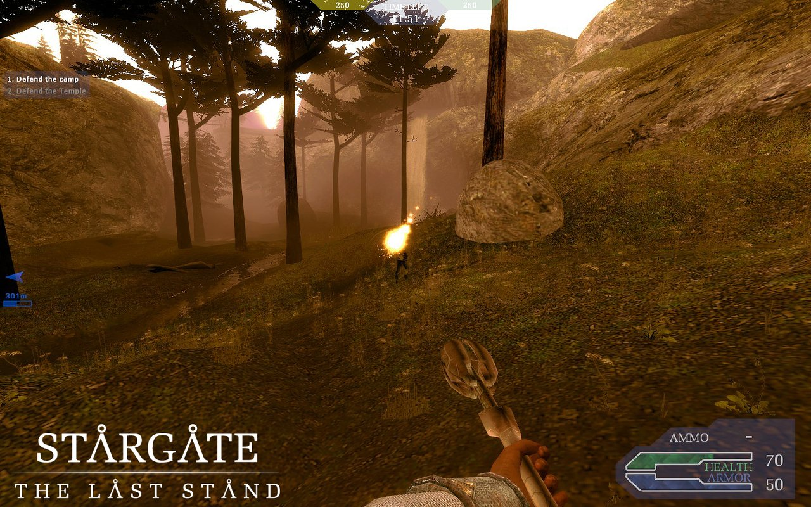
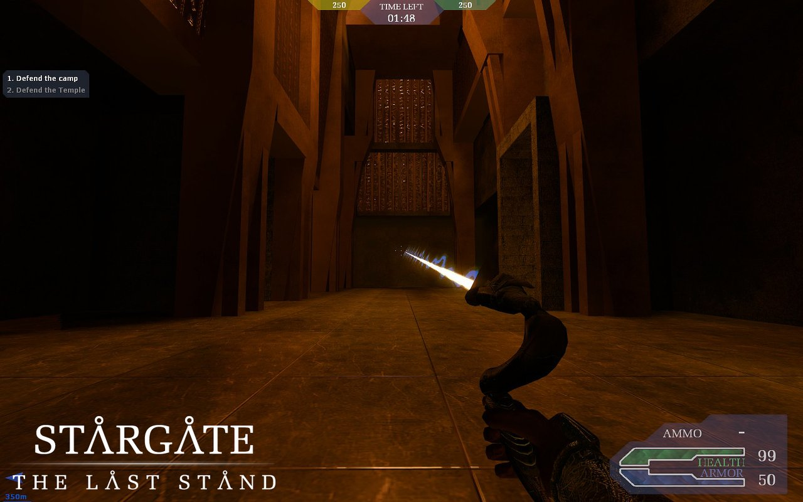
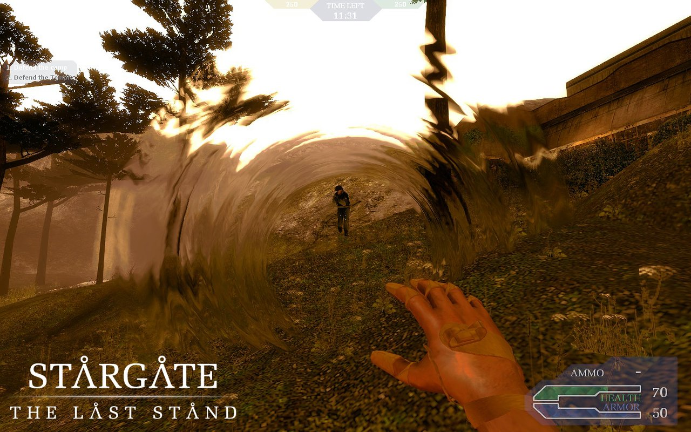

# Stargate TLS: Redial

 **[English](#english)** &nbsp;·&nbsp;  **[Français](#francais)**

 Bots for Stargate: The Last Stand, which attack and defend the objectives. Part of **[Stargate Redial](https://github.com/Stargate-Redial)**.

 Des bots pour Stargate: The Last Stand, qui attaquent et défendent les objectifs. Fait partie de **[Stargate Redial](https://github.com/Stargate-Redial)**.

| | | |
|---|---|---|
|  |  |  |

**Discord:** [discord.com/invite/SgHPP4mZyB](https://discord.com/invite/SgHPP4mZyB) &nbsp;·&nbsp; **24/7 server:** `connect 92.222.243.147:27031`

---

##  English

An unofficial add-on for **Stargate: The Last Stand** (1.1), the Stargate SG-1 mod for Half-Life 2:

- **It adds bots** that pick a team, a class and its equipment, then attack or defend the objectives: capture zones, buttons, the DHD.
- The main menu says "Redial V1.0.0".

*Made with love by [@CreepyInpu](https://x.com/CreepyInpu).*

### Quick start

1. Install **Source SDK Base 2007** from Steam: in your Library, under Tools, or press Win+R and run `steam://install/218`.
2. Install **Stargate: The Last Stand 1.1** ([ModDB](https://www.moddb.com/mods/stargate-the-last-stand/downloads/stargate-the-last-stand-11-client-full)). The mod goes into `Steam\steamapps\sourcemods\sgtls`.
3. Download **`stargatetls-redial-v1.0.0.zip`** from [Releases](../../releases), extract it anywhere and double-click **`install.bat`**.
4. Restart Steam and launch **Stargate: The Last Stand**. Then either:
   - **Create Server** on `tls_abydos`, with 32 slots if you can (with fewer, the mod closes parts of some maps): bots join and fill the game up to 10 players;
   - or join the 24/7 server: **Find Servers > Internet**, or `connect 92.222.243.147:27031` in the console.

### Installation details

- **The installer** finds Steam and the mod by itself. It backs up every file it replaces in a `redial-backup` folder, and you can run it again safely. Options:
  - `install.bat -ModDir "<path>\steamapps\sourcemods\sgtls"` if the mod isn't found;
  - `install.bat -NoSplash` to keep the mod's own menu background.
- **To uninstall,** run **`uninstall.bat`**.
- **What the installer changes,** and how to do it by hand: [docs/DETAILS.md](docs/DETAILS.md).

### Play online

A server runs 24/7 with bots, so there's always a match: `connect 92.222.243.147:27031`. Bots leave as players join. Come and say hello on the [Discord](https://discord.com/invite/SgHPP4mZyB).

### Controlling the bots

Bots join by themselves, balance the teams and spread over the classes. Each class has two equipment sets planned within the mod's weight limit. The settings are in a block at the end of `cfg\listenserver.cfg` (a game created from the menu) and `cfg\server.cfg` (a dedicated server).

| Console command | Effect |
|---|---|
| `botrix config bot quota 12` | total of players + bots to keep (0 = no automatic bots) |
| `botrix config bot intelligence normal pro` | skill range: fool, stupied, normal, smart, pro |
| `botrix bot add` | add a bot |
| `botrix bot kick all` | remove every bot |
| `botrix bot` | list the bot commands |
| `sgtls_objectives` | what the bots know about the map: objectives, buttons, teleporters |

A map can have its own total in `cfg\botrix_<map>.cfg`.

All of this is native to the mod: you join a round in progress, as the dead and newcomers respawn in waves. There are no tickets and no weapon packs: each class picks its equipment within a weight limit.

### Maps

| Map | Bots |
|---|---|
| tls_abydos | The Goa'uld attack the zones, the Tau'ri defend them, and each capture moves the match on. |
| tls_lockdown | The Tau'ri break out through the window, then play the bomb, the breaker and the iris; the Goa'uld dial the DHD to come back and defend the iris. |
| tls_erebus | The Tau'ri take the first point, then attack the camp; the Goa'uld come out of the temple at the last stage. |

Other maps have no waypoints: the bots won't move there.

### If something goes wrong

- **There are no bots:** type `plugin_print` in the console. Botrix should be listed. If not, run `install.bat` again and read its output.
- **The installer can't find the mod:** pass `-ModDir` (see above).

---

##  Français

Un ajout non officiel pour **Stargate: The Last Stand** (1.1), le mod Stargate SG-1 de Half-Life 2 :

- **il ajoute des bots** qui choisissent une équipe, une classe et son équipement, puis attaquent ou défendent les objectifs : zones de capture, boutons, DHD ;
- le menu principal affiche « Redial V1.0.0 ».

*Fait avec amour par [@CreepyInpu](https://x.com/CreepyInpu).*

### Démarrage rapide

1. Installez **Source SDK Base 2007** depuis Steam : dans votre bibliothèque, rubrique Outils, ou avec Win+R puis `steam://install/218`.
2. Installez **Stargate: The Last Stand 1.1** ([ModDB](https://www.moddb.com/mods/stargate-the-last-stand/downloads/stargate-the-last-stand-11-client-full)). Le mod va dans `Steam\steamapps\sourcemods\sgtls`.
3. Téléchargez **`stargatetls-redial-v1.0.0.zip`** dans les [Releases](../../releases), extrayez-le n'importe où, puis double-cliquez sur **`install.bat`**.
4. Redémarrez Steam et lancez **Stargate: The Last Stand**. Ensuite :
   - **Create Server** sur `tls_abydos`, avec 32 places si possible (en dessous, le mod ferme des parties de certaines cartes) : des bots rejoignent la partie et la complètent jusqu'à 10 joueurs ;
   - ou rejoignez le serveur 24/7 : **Find Servers > Internet**, ou `connect 92.222.243.147:27031` dans la console.

### Détails d'installation

- **L'installeur** trouve Steam et le mod tout seul. Il sauvegarde chaque fichier qu'il remplace dans un dossier `redial-backup`, et on peut le relancer sans risque. Options :
  - `install.bat -ModDir "<chemin>\steamapps\sourcemods\sgtls"` si le mod n'est pas trouvé ;
  - `install.bat -NoSplash` pour garder le fond de menu d'origine du mod.
- **Pour désinstaller,** lancez **`uninstall.bat`**.
- **Ce que l'installeur modifie,** et comment le faire à la main : [docs/DETAILS.md](docs/DETAILS.md) (en anglais).

### Jouer en ligne

Un serveur tourne 24h/24 avec des bots, donc il y a toujours une partie : `connect 92.222.243.147:27031`. Les bots cèdent leur place aux joueurs. Venez dire bonjour sur le [Discord](https://discord.com/invite/SgHPP4mZyB).

### Contrôler les bots

Les bots arrivent seuls, équilibrent les équipes et se répartissent entre les classes. Chaque classe a deux équipements prévus, dans la limite de poids du mod. Les réglages sont dans un bloc à la fin de `cfg\listenserver.cfg` (partie créée depuis le menu) et de `cfg\server.cfg` (serveur dédié).

| Commande console | Effet |
|---|---|
| `botrix config bot quota 12` | total de joueurs + bots à maintenir (0 = pas de bots automatiques) |
| `botrix config bot intelligence normal pro` | niveaux des bots : fool, stupied, normal, smart, pro |
| `botrix bot add` | ajoute un bot |
| `botrix bot kick all` | retire tous les bots |
| `botrix bot` | liste les commandes des bots |
| `sgtls_objectives` | ce que les bots savent de la carte : objectifs, boutons, téléporteurs |

Une carte peut avoir son propre total dans `cfg\botrix_<carte>.cfg`.

Tout cela est natif dans le mod : on rejoint une manche en cours, car les morts et les nouveaux réapparaissent par vagues. Il n'y a ni tickets ni packs d'armes : chaque classe choisit son équipement dans une limite de poids.

### Cartes

| Carte | Bots |
|---|---|
| tls_abydos | Les Goa'uld attaquent les zones, les Tau'ri les défendent, et chaque capture fait avancer la partie. |
| tls_lockdown | Les Tau'ri sortent par la vitre, puis jouent la bombe, le disjoncteur et l'iris ; les Goa'uld composent le DHD pour revenir défendre l'iris. |
| tls_erebus | Les Tau'ri prennent le premier point, puis attaquent le camp ; les Goa'uld sortent du temple à la dernière étape. |

Les autres cartes n'ont pas de waypoints : les bots n'y bougeront pas.

### En cas de problème

- **Pas de bots :** tapez `plugin_print` dans la console. Botrix doit apparaître. Sinon, relancez `install.bat` et lisez ce qu'il affiche.
- **L'installeur ne trouve pas le mod :** passez `-ModDir` (voir plus haut).

---

## Stargate Redial

Stargate mods brought back to life, with bots and a server running 24/7 · Les mods Stargate qui reprennent vie, avec des bots et un serveur 24h/24:

| Project | Game | 24/7 server |
|---|---|---|
| [StargateTC: Redial](https://github.com/Stargate-Redial/stargatetc-redial) | StargateTC 2.0 (Half-Life) | `connect 92.222.243.147:27030` |
| [StargateTC 2: Redial](https://github.com/Stargate-Redial/stargatetc2-redial) | StargateTC 2 (Source SDK Base 2006) | `connect 92.222.243.147:27032` |
| **Stargate TLS: Redial** | Stargate: The Last Stand (Source SDK Base 2007) | `connect 92.222.243.147:27031` |

Discord: [discord.com/invite/SgHPP4mZyB](https://discord.com/invite/SgHPP4mZyB)

## Credits

- **Stargate TLS: Redial:** [@CreepyInpu](https://x.com/CreepyInpu). Bug reports go to this repository's issues.
- **Stargate: The Last Stand:** its development team. The screenshots above come from the mod's [ModDB page](https://www.moddb.com/mods/stargate-the-last-stand).
- **Botrix:** Boris Godin ([borzh/botrix](https://github.com/borzh/botrix)). The bots here are Botrix with a Stargate: The Last Stand port: [src/](src/).
- **Source SDK Base, Half-Life 2:** Valve. **Stargate SG-1** is a trademark of MGM.

This is a fan project, not affiliated with the Stargate: The Last Stand team, Valve or MGM. You need your own copy of the mod; this repository does not redistribute it. License: see [LICENSE](LICENSE) and [THIRD-PARTY.txt](THIRD-PARTY.txt). Building from source: [docs/BUILDING.md](docs/BUILDING.md). Hosting a Linux dedicated server: [docs/LINUX_SERVER.md](docs/LINUX_SERVER.md).
